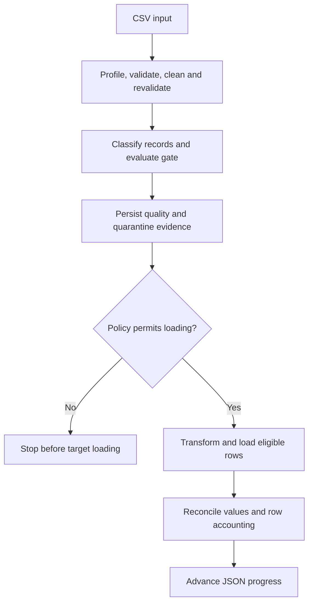
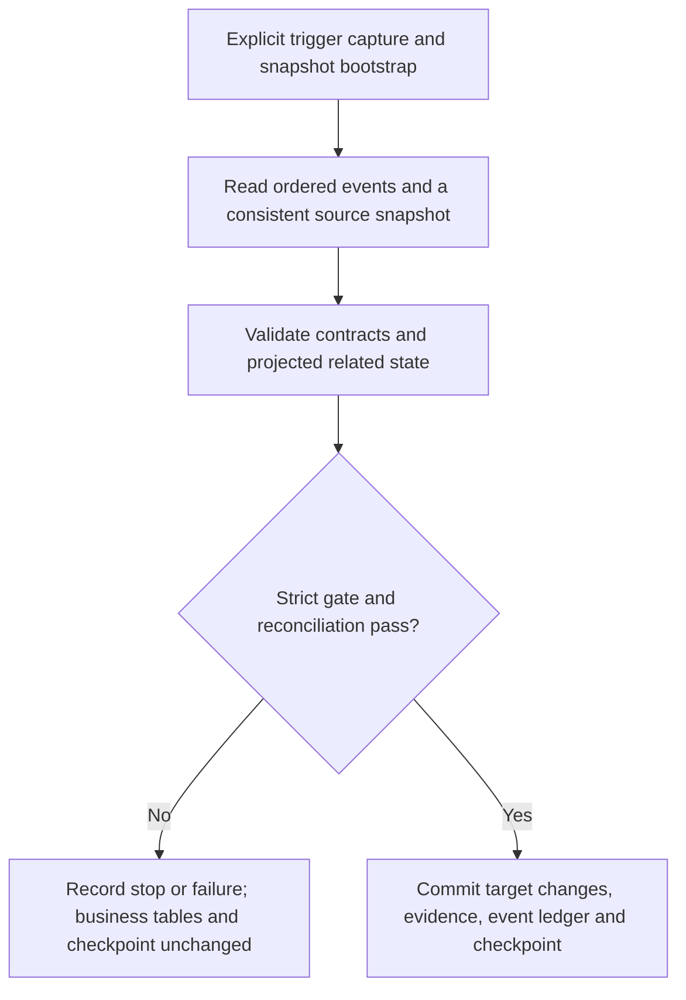

# Governed Data Pipeline

Incoming data can fail validation, and interrupted loads can leave progress out
of step with stored records. Governed Data Pipeline demonstrates explicit data
contracts, CSV quarantine, value reconciliation and replay-safe loading for
local workflows.

Reusable Python engines support CSV-to-SQLite processing and local SQLite
trigger-based insert, update and delete capture, with recorded quality and run
evidence. The project demonstrates data-engineering practices relevant to
analytics preparation, data quality and governance.

**Python 3.11+ · pandas / NumPy · CSV and SQLite · MIT licensed**

[](https://github.com/daudakamandadk-lang/governed-data-pipeline/actions/workflows/ci.yml)

[Quick start](#quick-start) · [Demonstrated outcomes](#demonstrated-outcomes) ·
[Architecture](#architecture) · [Documentation](docs/README.md)

## What it does

| Capability | Behaviour |
| --- | --- |
| Extraction | Full-file, chunked and incremental file readers; read-only SQLite snapshots and composite cursors |
| Quality controls | Before/after profiles, explicit typed contracts, recorded cleaning and row-level routing |
| Governed CSV loading | Durable quarantine, insert/reuse/conflict handling and value reconciliation before JSON progress advances |
| SQLite change capture | Explicit insert/update/delete triggers, related-table checks and ordered event consumption |
| Run evidence | Run IDs, configuration identity, quality reports and replay checks |

Use this package on its own or as a component in a larger analytical workflow.
Dataset generation, statistical analysis, models and application decisions
remain in the consuming project. No datasets are bundled; demonstrations
generate small neutral synthetic inputs locally when explicitly run.

## Engineering decisions

- **Make acceptance explicit.** Contracts define types, required values,
  uniqueness and relationships. Cleaning records permitted corrections, then
  validation runs again.
- **Keep invalid records visible.** CSV quality failures stop loading under the
  default strict policy. An explicitly permissive policy can retain quarantine
  evidence and load eligible rows. Invalid related state stops a SQLite change batch.
- **Check values before recording progress.** Reconciliation checks persisted
  values as well as row accounting. CSV progress advances only after these
  checks and unchanged source/reference fingerprints.
- **Make recovery deliberate.** Identical existing CSV rows are reused;
  conflicting values stop the load. SQLite changes, successful evidence,
  consumed-event records and the checkpoint commit together in the target.

## Architecture

Engines perform focused operations; orchestrators control policy, ordering and
progress. The two connected workflows have different recovery boundaries.

### CSV to SQLite



SQLite target writes and JSON progress commit separately. Identical-row replay
supports recovery when loading succeeds but progress is not saved.

### Local SQLite snapshots and changes



The final successful commit is one target SQLite transaction. Source and target
transactions remain separate. See [architecture](docs/architecture.md),
[engine responsibilities](docs/engine_boundaries.md) and
[reconciliation and recovery](docs/reconciliation.md) for the full stage order
and failure behaviour.

## Demonstrated outcomes

These outcomes use the supplied synthetic demonstrations in fresh local state.
They are also asserted by the automated tests; they are examples of behaviour,
not performance benchmarks or measurements of a live business system.

| Scenario | Expected result | Engineering point |
| --- | --- | --- |
| Clean CSV | Six records loaded; progress advances to 6 | Reconciliation before progress |
| Repeat clean CSV | `no_new_rows`; no additional inserts | Saved progress avoids reloading older records |
| Dirty CSV, strict policy | Three eligible and three quarantined; no target load | A stopped batch can contain eligible rows |
| Dirty CSV, explicit quarantine policy | Eligible keys 1, 2 and 6 loaded; quarantine evidence retained | Bad records remain visible when partial loading is permitted |
| SQLite bootstrap and five captured changes | Two rows remain in each table; checkpoint advances to 5 | Related-state checks and atomic target progress |
| Repeat SQLite consumption | `no_changes` | Already consumed events do not apply again |

Run them using the [quick start](#quick-start) and
[demonstration commands](#demonstrations). Inspect the
[latest CI status](https://github.com/daudakamandadk-lang/governed-data-pipeline/actions/workflows/ci.yml)
or the [recorded verification evidence](docs/verification.md).

## Quick start

Clone the repository and install from its root. On macOS or Linux:

```bash
git clone https://github.com/daudakamandadk-lang/governed-data-pipeline.git
cd governed-data-pipeline
python3 -m venv .venv
.venv/bin/python -m pip install -e .
.venv/bin/python -m governed_data_pipeline --scenario clean
```

On Windows PowerShell:

```powershell
git clone https://github.com/daudakamandadk-lang/governed-data-pipeline.git
cd governed-data-pipeline
python -m venv .venv
.\.venv\Scripts\python.exe -m pip install -e .
.\.venv\Scripts\python.exe -m governed_data_pipeline --scenario clean
```

A fresh clean run loads six records and advances progress to 6. Repeat the
command to get `no_new_rows` without additional inserts. Source, target and
progress files are written beneath ignored `data/local/governed_demo_v3/`.
Existing inputs are preserved.

Commands below use `python` from your environment. Use `.venv/bin/python` or
`.\.venv\Scripts\python.exe` directly if the environment is not activated.
Optional Excel/Parquet readers can be installed with
`python -m pip install -e ".[file-formats]"`.

## Demonstrations

### CSV quality gates

```bash
python -m governed_data_pipeline --scenario dirty
python -m governed_data_pipeline --scenario dirty --allow-quarantine
```

The strict run identifies three eligible and three quarantined records, then
stops before loading. The explicitly permissive run retains quarantine evidence
and loads eligible keys 1, 2 and 6. Each scenario uses its own input and state.

### SQLite snapshots and changes

Run these commands in order:

```bash
python -m governed_data_pipeline.database_demo --action bootstrap
python -m governed_data_pipeline.database_demo --action mutate
python -m governed_data_pipeline.database_demo --action changes
python -m governed_data_pipeline.database_demo --action changes
```

Bootstrap loads two customers and two orders. Mutation records five events in
one source transaction: one update, two inserts and two deletes. Consumption
leaves two rows in each table and advances the checkpoint to 5. The final repeat
reports `no_changes`. Files stay beneath ignored `data/local/database_demo/`.

Successful target changes, quality evidence, consumed-event records and the
checkpoint commit in one target SQLite transaction. Capture is installed only
in the demonstration source. For custom sources, installation requires an
explicit `--install-capture` decision. See [database and CDC](docs/database_cdc.md).

## Use your own data

```bash
python -m governed_data_pipeline --config path/to/csv_job.json
python -m governed_data_pipeline.database_demo --action bootstrap --config path/to/database_job.json
```

Custom jobs require existing inputs and reviewed contracts; they generate no
sample source. Relative paths resolve from the working directory. The CSV
[example configuration](configs/governed_demo.json) shows schema, gate,
transformation and state settings. See [configuration](docs/configuration.md) for
setup and state boundaries.

Engines also support direct Python use:

```python
from governed_data_pipeline import CleaningEngine, profile_data, validate_fields

profile = profile_data(data)
cleaned = CleaningEngine().clean(data, schema)
validation = validate_fields(cleaned.data, schema)
```

Supply a pandas DataFrame and an explicit schema. Cleaning operates on a copy
and records corrections and unresolved issues. See the runnable
[independent engines example](examples/independent_engines.py),
[data contracts](docs/data_contracts.md) and [public interfaces](docs/engine_boundaries.md).
New gate callers should use `evaluate_score_gate` or `evaluate_record_gate` to
make their intent explicit.

## Verification

```bash
python -B -m unittest discover -s tests -p 'test_*.py' -v
python -B scripts/privacy_check.py
```

Tests use temporary synthetic inputs and cover replay, drift, invalid changes
and failure boundaries. CI runs the tests, publication scan and package build.
The scan checks configured patterns; it does not replace reviewing staged
changes. Recorded local results and tested environment details are in
[verification](docs/verification.md).

## Operating boundaries

The connected workflows use local files and one pipeline writer. CSV processing
rereads the source and assumes increasing unique integer IDs. Advancing past a
quarantined ID does not automatically select a repaired historical row.

Database consumption reads the selected snapshot and retained event history;
bounded event batching and retention management are not implemented. Source
and target transactions are separate. CSV target writes and JSON progress also
commit separately, with identical-row replay supporting recovery. SQLite REAL
uses floating-point storage.

Profiling reports observations and configured failures; it does not establish
source accuracy. Contract or target-layout changes require explicit review.
Remote adapters, concurrent writers, scheduling and production deployment need
additional design and verification. See [reconciliation and recovery](docs/reconciliation.md)
and the [roadmap](docs/roadmap.md).

## Documentation and contributing

- [Documentation index](docs/README.md): architecture, contracts, gates and workflow details.
- [Contributing](CONTRIBUTING.md): development setup and change verification.
- [Migration notes](docs/migration.md): imports, gate interfaces and existing state.
- [Security and privacy](SECURITY.md) and [source provenance](metadata/README.md): safe local data use.

Software terms are in [LICENSE](LICENSE) and the [project notice](PORTFOLIO_NOTICE.md).
Caller-owned input licences and permissions remain separate.
